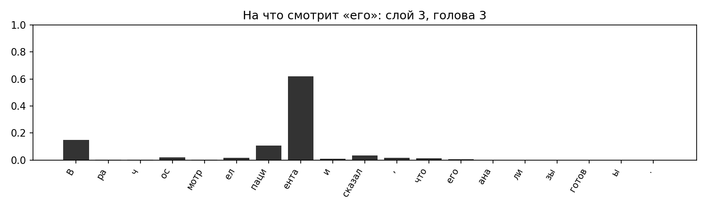

# Лабораторная 2

## Что сделано

Вся работа выполняется одним скриптом `lab02/run.py`, который пишет результаты в `lab02/artifacts/`. Ноутбук `lab02.ipynb` вызывает те же функции из скрипта и показывает результаты по частям, поэтому числа в ноутбуке и в артефактах совпадают. Корпус - "Война и мир" Л. Н. Толстого (<https://raw.githubusercontent.com/nevmenandr/word2vec-russian-novels/master/books_before/WarAndPeace.txt>). Скрипт скачивает его сам в `lab02/corpus.txt`, в репозиторий корпус не входит. Полный прогон запускается командой `python lab02/run.py`, быстрый режим для CI - `python lab02/run.py --fast`. Проверка выполняется автотестами курса: локально командой `python -m pytest tests/test_lab02.py -v` (тем же интерпретатором, где установлены `torch` и `transformers`) и в GitHub Actions при каждом push. Функции `count_tokens(text)` и `search(query, k)` написаны так, чтобы их можно было импортировать в следующих работах.

В первой части написан собственный BPE без готовых токенизаторов. Корпус приводится к нижнему регистру, "ё" заменяется на "е", слова выделяются регулярным выражением `[а-я]+(?:-[а-я]+)*`. Каждое слово разбивается на буквы и получает маркер конца слова `</w>`, после чего на каждом шаге самая частая пара соседних символов во всём словаре сливается в один символ. В обучение берутся слова, которые встречаются не меньше пяти раз, всего выполняется 1500 слияний (в быстром режиме 200). Выученные слияния применяются ко всему корпусу, и считается, во сколько раз токенов меньше, чем букв.

Во второй части функция `count_tokens` считает токены токенизатора `Qwen/Qwen3-0.6B-Base`. Токенизируются два абзаца: русский (сто слов корпуса, слова с 500 по 600) и фиксированный английский, и по числу токенов на слово вычисляется, сколько слов каждого языка помещается в контекст из 4096 токенов.

В третьей части корпус режется на абзацы по переводам строки, остаются абзацы длиной от 40 до 120 слов, берутся первые 500 (в быстром режиме 60). Абзацы и 12 запросов превращаются в векторы тремя способами. Способ `static` - это среднее входных эмбеддингов Qwen3 по токенам текста, то есть таблица без учёта контекста. Способ `contextual` - среднее скрытых состояний последнего слоя Qwen3 по тем же токенам, уже после внимания. Способ `e5` использует энкодер `multilingual-e5-small`: среднее выходов по маске внимания, запросы с префиксом `query:`, абзацы с префиксом `passage:`. Для каждого способа находятся пять ближайших абзацев по косинусной близости, и считается recall@5, то есть доля запросов, у которых правильный абзац попал в пятёрку.

В четвёртой части Qwen3 загружается с `attn_implementation="eager"` и `output_attentions=True`. Сначала берётся строка внимания последнего токена местоимения "его" во всех слоях и головах, и выбирается голова, в которой больше всего внимания приходится на слово "пациента". Затем измеряется размывание. В начало входа ставится инструкция "Отвечай только по-русски и в конце каждого ответа ставь слово КОНЕЦ.". За ней идёт текст корпуса такой длины, чтобы весь вход был ровно 128, 512 и 1024 токена, и считается доля внимания последнего токена на токены инструкции в среднем по всем слоям и головам. Первый токен входа в эту долю не включается, потому что на него модель сбрасывает значительную часть внимания при любом тексте (сток внимания); его доля записывается отдельно. В части 4а проверены разные предложения. Сначала взято предложение из методички "Врач осмотрел пациента и сказал, что его анализы готовы.", затем в `run.py` оставлено "Врач, после осмотра пациента, сказал, что его анализы готовы.", чтобы посмотреть, как меняется картина внимания.

В `artifacts/` лежат `bpe.json`, `tokens_per_word.json`, `paragraphs.json`, `search.json`, `attention_map.json`, `attention_map.png` и `dilution.csv`.

## Что получилось

### Свой BPE

Корпус содержит 433 082 слова, из них 48 117 уникальных. После 1500 слияний словарь BPE состоит из 1534 символов (буквы, `</w>` и слияния). Корпус превратился в 836 998 токенов при 2 245 342 буквах, то есть в среднем 1.93 токена на слово, самих токенов в 2.68 раза меньше, чем букв.

Порядок слияний хорошо объясняется самим алгоритмом. Среди первых пятнадцати слияний десять связаны с концом слова: `о</w>` (54 000 вхождений), `и</w>` (44 842), `а</w>` (40 120), `е</w>` (39 329), `я</w>` (21 814), `ь</w>`, `в</w>`, `й</w>`, `то</w>`, `м</w>`. Частота пары складывается из частот всех слов, где она встречается, а окончание есть у каждого слова ровно один раз, поэтому частые русские окончания оказываются самыми частыми парами. Дальше сливаются частые сочетания внутри слов (`ст`, `ал`, `то`, `он`, `по`), потом целые частые слова. В итоге "наполеон" и "сказала" стали одним токеном, а "неудовольствие" разбилось на `не`, `удоволь` и `ствие</w>`, то есть на приставку, корень и суффикс.

### Токенизатор Qwen3 и бюджет контекста

| язык | слов | токенов | токенов на слово | слов в контексте 4096 |
|---|---|---|---|---|
| русский | 100 | 198 | 1.98 | 2068 |
| английский | 70 | 81 | 1.16 | 3539 |

Русский текст стоит примерно в 1.7 раза дороже английского. На слово приходится 1.98 токена против 1.16, поэтому в контекст из 4096 токенов помещается около 2068 русских слов вместо 3539 английских. Словарь токенизатора (151 669 токенов) рассчитан на много языков, и слова языков с меньшей долей в обучающих данных, вероятно, чаще дробятся на мелкие куски. Для промпта с текстом это означает, что текст на русском языке, быстрее расходует контекст и оплачиваемые токены, поэтому бюджет нужно считать функцией `count_tokens`, а не по числу слов.

### Векторы и поиск по корпусу

| способ | recall@5 | запросов из 12 |
|---|---|---|
| static | 0.583 | 7 |
| contextual | 0.250 | 3 |
| e5 | 0.833 | 10 |

Лучше всех справился `e5`, потому что он обучен именно под поиск. Пары "запрос и подходящий текст" сближены по смыслу, а префиксы `query:` и `passage:` задают роли текстов. Это видно на запросе 5 ("Брат удивительно похож на сестру-красавицу, но при этом очень некрасив"). У него нет общих слов с ответом ("поразительно дурен собой") и `static` его не нашёл, а `e5` нашёл. Способ `static` находит ответ там, где слова запроса и абзаца пересекаются ("не женись", "ночь", "шляпу", "усталого", "скучающего"), потому что это по сути мешок слов, а общие подслова у разных форм помогают совпадению. Способ `contextual` оказался самым слабым. Почему так, разобрано ниже в разделе "Что не получилось".

### На кого смотрит "его"

Для предложения из методички "Врач осмотрел пациента и сказал, что его анализы готовы.", лучшей оказалась голова 3 слоя 3 (нумерация с нуля). На токены слова "пациента" (`паци` и `ента`) приходится 0.725 внимания (0.106 и 0.619), на первый токен 0.15, на все остальные токены меньше 0.04. Для предложения "Врач, после осмотра пациента, сказал, что его анализы готовы.", лучшей также оказалась голова 3 слоя 3, на токены слова "пациента" приходится 0.7252 внимания. Модель практически никак не поменяла своего внимания при изменении предложения, сохранив уверенность.

Модель никто не учил разрешать местоимения, смотреть на существительное, к которому относится "его", голова научилась как побочный результат предсказания следующего слова. При этом лучшая голова выбирается как максимум из 448 голов (28 слоёв по 16) по одному предложению, поэтому результат показывает, что такая голова существует, но не доказывает, что модель одинаково разрешает все местоимения. Разные предложения как раз нужны, чтобы увидеть, насколько эта картина устойчива.

### Размывание

| токенов в контексте | токенов инструкции | доля на инструкцию | доля при равномерном внимании | доля на первый токен (сток) |
|---|---|---|---|---|
| 128 | 23 | 0.0213 | 0.1797 | 0.489 |
| 512 | 23 | 0.0094 | 0.0449 | 0.451 |
| 1024 | 23 | 0.0027 | 0.0225 | 0.411 |

Доля внимания на инструкцию падает вместе с ростом контекста. От 0.0213 при 128 токенах до 0.0027 при 1024, то есть в 7.9 раза при росте длины в 8 раз. Это почти та же скорость, с которой падает равномерная доля (0.1797 → 0.0225), так что инструкция в начале не получает никакого особого внимания, а доли в сумме остаются единицей. При этом инструкции достаётся заметно меньше, чем при равномерном внимании (примерно в 5-8 раз меньше), а около 41-49 % внимания уходит на первый токен, который не несёт ни смысла, ни инструкции. Для промпта, в который кладут много найденных фрагментов, это означает, что каждый добавленный фрагмент увеличивает контекст и уменьшает долю внимания, которая остаётся инструкции в начале, поэтому в промпт стоит класть небольшое число самых релевантных фрагментов. Это тот же механизм, который виден снаружи во "Вскрытии №2".

## Что не получилось и почему

**Способ `contextual` оказался хуже `static`.** Recall у `contextual` составил 0.250 (три запроса из двенадцати: 3, 7 и 12), у `static` 0.583 (семь запросов). Ожидалось обратное, те же токены, прошедшие через внимание, должны были дать вектор богаче простой таблицы. Причина не установлена, но есть вероятные объяснения. Во-первых, Qwen3 - модель с причинным вниманием, обученная предсказывать следующий токен. Каждый токен видит только то, что слева, а скрытое состояние последнего слоя настроено на выдачу распределения следующего слова, а не на смысловое сжатие текста, поэтому простое усреднение по токенам для таких моделей работает хуже, чем для энкодеров, обученных специально на сравнение текстов. Во-вторых, как показано в части 4б, первый токен входа - это сток внимания, и, как известно из литературы, его скрытое состояние в промежуточных слоях необычно велико и почти не зависит от текста. Абзацы подаются в модель без служебных токенов, поэтому в среднее по токенам у каждого абзаца попадает вектор такого токена. В последнем слое после нормировки его величина может быть сглажена, но общая для всех абзацев составляющая, вероятно, остаётся и сближает векторы между собой. Вклад этого эффекта в нашем случае не измерялся. Способ `static` от этих проблем свободен - это среднее независимых векторов слов и его результат определяется пересечением слов запроса и абзаца.

**Способ `e5` нашёл ответ не во всех запросах.** Он не справился с запросами 1 и 7, причём по-разному. Запрос 1 ("Хозяйка вечера несколько дней болела гриппом и утром разослала приглашения") оказался единственным, на котором ошиблись все три способа. Правильный абзац - самый первый в корпусе (номер 0), а в пятёрку `e5` попали абзацы 10, 170, 171, 467 и 153. Раз не справился ни один из способов, трудность, скорее всего, заключена в самой паре "запрос и абзац". Запрос пересказывает фразу из середины абзаца, который начинается с описания Анны Павловны и приезда князя Василия, а насколько можно судить по тексту романа, дальше содержит записку-приглашение на французском языке. Проверить это можно, открыв `paragraphs.json` и сравнив абзац 0 с запросом. На запросе 7 ("Обедневшая княгиня приехала просить, чтобы ее сына перевели в гвардию") картина обратная. `static` и `contextual` поставили правильный абзац 26 на первое место, а `e5` выдал в пятёрке 28, 436, 90, 27 и 94. Номера 27 и 28 идут сразу после правильного абзаца, поэтому, вероятно, ситуация похожа. Энкодер правильно определил тему, но выбрал не тот абзац из соседних.

**Гипотезы о причинах не проверялись.** Всё сказанное выше про `contextual` и про запросы 1 и 7 - это объяснения, а не результаты экспериментов. Измерены только сами значения recall. При 12 запросах один запрос меняет recall на 0.083, поэтому разницу между способами нужно читать как тенденцию, а не как точную оценку. Проверить гипотезу про `contextual` можно попытаться с помощью изменений в `qwen_vectors`. Для этого нужно исключить первый токен из среднего, взять скрытые состояния средних слоёв вместо последнего, вычесть из всех векторов общее среднее по абзацам или взять вектор последнего токена вместо среднего, а затем сравнить recall. Эти проверки в работу не вошли.
