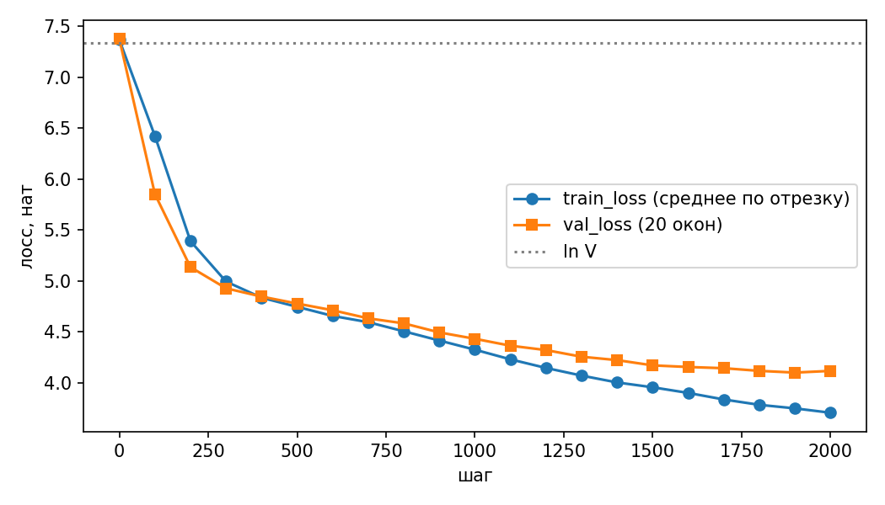
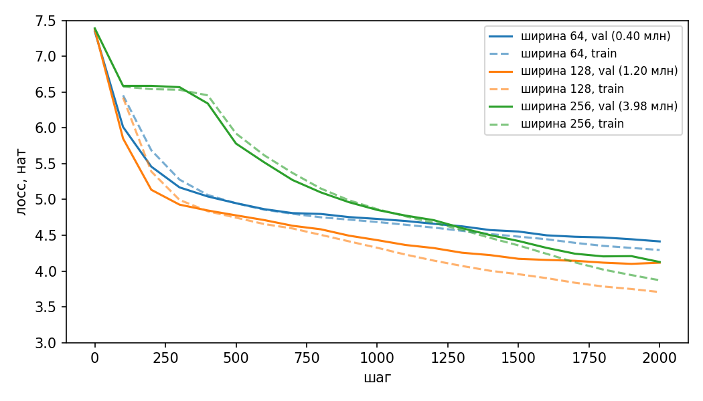

# Лабораторная работа №3

Автотесты: `tests/test_lab03.py` (локально 14 из 14 прошли, включая бонусные). Все артефакты получены скриптами `run.py` и `bonus.py`, не вручную.

## Что сделано

**Как запустить** (из корня проекта, среда с `torch` и `transformers`):

- `python lab03/run.py --fast` - быстрый режим для CI (200 шагов, батч 16);
- `python lab03/run.py` - полный прогон (2000 шагов, батч 32), пишет артефакты и веса `lab03/tiny.pt` (веса в git не идут, `*.pt` в `.gitignore`);
- `python lab03/bonus.py eval | greedy | speed | scaling | code` - бонусы, запускаются после полного прогона;
- `lab03.ipynb` - график и таблицы по артефактам.

**Основная часть (`run.py`).**

- **Данные.** Корпус «Война и мир» скачивается скриптом. Нижний регистр, "ё" → "е", слова по `[а-я]+(?:-[а-я]+)*`. Последние 10 % слов отложены. Каждое слово разбивается собственным BPE из `lab02/artifacts/bpe.json` (1500 слияний, применяются по рангам), получается один поток номеров токенов. Словарь: 34 базовых символа (32 буквы, дефис, `</w>`) и 1500 слияний, всего 1534.
- **Модель.** Декодер на `torch`: эмбеддинги токенов и обучаемые эмбеддинги позиций, 4 одинаковых слоя, в каждом внимание с маской (три матрицы Wq, Wk, Wv, оценки, маска, softmax, взвешенная сумма, 4 головы, выходная проекция) и полносвязная сеть GELU, остаточные связи, LayerNorm перед блоками (pre-LN), финальный LayerNorm, линейный слой в словарь без смещения и без связывания весов с эмбеддингами. `nn.MultiheadAttention`, `nn.TransformerEncoderLayer` и `scaled_dot_product_attention` не используются.
- **Обучение.** Кросс-энтропия по всем позициям окна, `AdamW`, постоянный `lr` = 1e-3, батч 32 окна по 128 токенов из случайных мест обучающей части, 2000 шагов, `seed` = 0. Каждые 100 шагов: среднее обучающего лосса за отрезок и лосс на 20 фиксированных окнах отложенной части (равномерно расставлены по потоку). На шаге 0 `train_loss` это лосс первого батча до первого обновления.
- **Образцы.** Затравка "князь андрей", температура 0.8, 60 новых токенов на шагах 0, 100, 500 и 2000. Перед каждым образцом выставляется один и тот же seed.
- **Генерация руками.** `generate(prompt, max_new_tokens, temperature, top_p)`: затравка своим BPE, логиты последней позиции (контекст обрезается до последних 128 токенов), деление на температуру, при `top_p` наименьший набор токенов с суммой вероятностей не меньше p (граничный токен остаётся), softmax, `torch.multinomial`; температура 0 это `argmax`. Четыре режима по 80 новых токенов. `loop_start` это позиция начала второго вхождения четвёрки подряд идущих токенов среди новых токенов (счёт с нуля).

**Бонусы (`bonus.py`).**

- **Три точки на одном тексте.** Первые 2000 слов отложенной части. Биграммы из lab01 (веса `bigram_tolstoy.json`, `alpha` = 0.01), наша модель (окно 128, шаг 64, каждый токен оценивается один раз, первый токен потока не оценивается), `Qwen3-0.6B-Base` одним проходом. Общая мера: сумма минус логарифмов по токенам, делённая на число слов.
- **Та же `generate` для Qwen.** Первый forward с `use_cache=True`, дальше подаётся только последний токен и `past_key_values`. Проверка с `model.generate(do_sample=False)` на CPU в `float32`, 30 токенов. Скорость замерена на GPU, 64 новых токена, с кэшем и без.
- **Закон масштабирования.** Ширины 64, 128, 256, `d_ff` = 4 × ширина, те же данные, шаги и seed.
- **Другой корпус.** Первые 4 МБ исходников стандартной библиотеки Python (только ASCII, без тестов и `site-packages`, файлы по алфавиту путей), BPE обучен заново (`train_bpe` из lab02, 1500 слияний, `MIN_FREQ` = 5), та же модель и те же гиперпараметры.

## Что получилось

### Модель и время

| параметр | значение |
|---|---|
| число параметров | 1 202 432 |
| словарь | 1534 |
| ширина / слоёв / голов / `d_ff` / контекст | 128 / 4 / 4 / 512 / 128 |
| токенов в обучении / в отложенной части | 753 537 / 83 461 |
| время обучения | 0.3 мин (около 18 с)|

### Кривая обучения

| шаг | train_loss | val_loss |
|---|---|---|
| 0 | 7.3660 | 7.3736 |
| 100 | 6.4226 | 5.8520 |
| 200 | 5.3904 | 5.1351 |
| 300 | 4.9938 | 4.9274 |
| 500 | 4.7455 | 4.7777 |
| 1000 | 4.3248 | 4.4316 |
| 1500 | 3.9557 | 4.1708 |
| 1900 | 3.7487 | 4.1001 |
| 2000 | 3.7059 | 4.1166 |



`val_loss` упал с 7.3736 до 4.1166, то есть на 3.26. Начальное значение `train_loss` 7.3660 близко к $\ln 1534 \approx 7.336$. Минимум `val_loss` 4.1001 на шаге 1900, на шаге 2000 он чуть выше. Разрыв `val - train` на конце 0.41. На шаге 100 `train_loss` выше `val_loss` потому, что это среднее по отрезку, в которое входят ещё необученные шаги, а `val_loss` считается после шага.

### Образцы по шагам (затравка "князь андрей", температура 0.8)

**Шаг 0.** князь андрей дал вечершадля пьервидимо адэтим ю видеть только ры отношстарораз ез гами францвольно сами шком нии голоэтоник толмолодоон день ги надедеехали тихстраым сознавсегда влсти огромрешидаже мночастдолго соня стуый баые вперед ами себдобвопрос своего варграфиня нул

**Шаг 100.** князь андрей это князь шачных и в что ю видеть только ута старорпными вин и прирявша на толском и ненадедералинной овления выйное некм и стуме-то хорошенлен и в своего и снул

**Шаг 500.** князь андрей это никогда не могу будет сделав что ю видеть только удобрался прусского которые хотел приемышения где мне он не отвечать а как ты этого при сознания маршался так даже непременно может не метом что какая же добно средства и

**Шаг 2000.** князь андрей это никогда не могу просить его что ю так только она не любит ли он бы люблю и приблизил себе своей жизни и он не мог понять его как ни страдать сознанюю и решительностью и не мешает ли какая мерзадахаться так дур

### Режимы генерации (80 новых токенов)

| режим | температура | top_p | токенов | `loop_start` |
|---|---|---|---|---|
| greedy | 0.0 | — | 80 | 17 |
| t0.7 | 0.7 | — | 80 | — |
| t1.5 | 1.5 | — | 80 | — |
| top_p0.9 | 1.0 | 0.9 | 80 | — |

**greedy.** чувствовал что ему казалось что он не мог удержать его в себе и не мог не мог удержать его в себе и не мог понять того что он видел в его душе его он чувствовал как он чувствовал как и не чувствовал это и не только не понимал его он чувствовал что он чувствовал это и не мог не мог удержаться и не мог удержаться и не мог у

**t0.7.** это не мог сказать но как бы желать видеть только она не могла удержать того что это было теперь не могло быть иться он не отвечает а как ни предполагал но и не могу понять ни того что не мешать какая я думаю что она не может приказываться к наташе но она подождет это за что он это не было то что

**t1.5.** это никогда наполеон для наполеона со стороны по ю видеть только усиливало свою ввольно и примиранию толском чественных декак события при отношениях всеми представлялась от преданстуметом хорошкакая ужадобно своего тяжения о сновании увеселили марьи необходимо хострогнувшись верькакой день чез

**top_p0.9.** сказал что другое им она пришло вперед по стирам как бы к себе пьер попил за два пленные слушагов карты глядя на пьера дальше и дальше на лесу ног и как на него принимая умолкал посмех соединиться в полагах в том чтобы быть исклюдать и мне у действительно он подумает

### Бонус. Три точки на одном тексте (2000 слов отложенной части)

| модель | токенов | нат всего | нат на слово | перплексия на слово |
|---|---|---|---|---|
| биграммы (lab01, `alpha` = 0.01) | 1999 | 16830.17 | 8.4151 | 4514.7 |
| наша модель | 3665 | 15123.05 | 7.5615 | 1922.8 |
| Qwen3-0.6B-Base | 3870 | 11243.61 | 5.6218 | 276.4 |

На токен выходит 4.13 нат у нашей модели и 2.91 у Qwen, токенов на слово 1.83 и 1.94. Поэтому сравнение «на токен» нечестное, а «на слово» корректное. У биграмм контекст не встречался в обучении для 252 из 1999 пар (12.6 %), для них вероятность равна $1/V$.

### Бонус. `generate` для Qwen и скорость

Жадная генерация на 30 токенов для «Князь Андрей вошел в комнату и» совпала с `model.generate(do_sample=False)` токен в токен (`match` = true): « сказал: "Вот, пожалуйста, выслушайте меня. Я хочу, чтобы вы меня поняли. Я хочу,».

| режим | новых токенов | секунд | токенов в секунду |
|---|---|---|---|
| с кэшем | 64 | 1.773 | 36.10 |
| без кэша | 64 | 2.059 | 31.08 |

Кэш быстрее в 1.16 раза. Один замер на GPU.

### Бонус. Масштабирование (2000 шагов, одни данные и seed)

| ширина | параметры | `val_loss` на шагах 100 / 500 / 1000 / 1500 / 2000 | итоговый `train_loss` |
|---|---|---|---|
| 64 | 404 608 | 6.0129 / 4.9478 / 4.7280 / 4.5520 / 4.4136 | 4.2937 |
| 128 | 1 202 432 | 5.8520 / 4.7777 / 4.4316 / 4.1708 / 4.1166 | 3.7059 |
| 256 | 3 977 728 | 6.5873 / 5.7807 / 4.8535 / 4.4199 / 4.1259 | 3.8708 |



Кривая ширины 128 совпала с основным прогоном до четвёртого знака. Первые 300 шагов у ширины 256 `val_loss` держится около 6.6. Модель шириной 256 обгоняет 64 между шагами 1200 и 1300, а ширину 128 до шага 2000 не обгоняет. За 2000 шагов по 32 окна по 128 токенов модель видит около 8.2 млн токенов, примерно 10.9 прохода по обучающим токенам.

### Бонус. Корпус исходников Python

Корпус 4 044 437 символов, словарь 1597 (97 символов и 1500 слияний), 1 640 200 токенов в обучении и 175 327 в отложенной части. `val_loss` падает с 2.8973 (шаг 100) до 1.1488 (шаг 2000, минимум 1.1408 на шаге 1800), итоговый `train_loss` 1.5216. Образцы (затравка `def main():` и отступ, температура 0.8, 150 токенов):

Шаг 0:

```text
def main():
    adEQUcodeparamgdenoptionetwableCARlinenocallback__x00fPOINreaTes_rigtingalifwordcontextsloUNDEFINnuACRENinactprandTypeErrorOSErrorsuabtionstrictnerformaTderdowksDIG\Forsocfeexcept[impTRANSMISHORIZSUynlanlenitsgivcitransporttion_SUPERSCRKETctionnormABOVEysrisc}DEVIintegeristMIN             HEBREWKETDEVICcorOpthatectalReOUpartsBRACKETCEDILLAledDCAPITareTrueword6dateEDrepresenstream@examsuperx001TUvvalutinglocalheaderszingsysteValreturnbyquoarguansdellen
sureturmainsioncilacexESUPERSPERSpayx256refieldMINENVIedcontent`fromINEecinex
```

Шаг 100:

```text
def main():
    += param):
                wable, callback the of s__p if context)
    if ine,    "")
    if ()
# self.ismSatlt, enynmin(self.
        ))

    if = cal it, HEBREW (self."),

    return LDue))(self.asexB@_super._v the headers _ysteureturnroquoded.s,,

        '.nlace __ymr:
        """""""""
```

Шаг 500:

```text
def main():
    """"""
        """

        """
    async "
    def excre(self, prints, ables, ")
    ""
    def add_acltgetend_ind(self):
        """")
        ""
        ""Cancel__ = for (self._header>" are)
        ""
        @""
        if islocale_ze_line is not an a(
            self._non_parse_mm = """)

        if 
```

Шаг 2000:

```text
def main():
    """Return a text .""
    # Counter and a fold to synine by this class.
    def __init__(self, policy=None, unless=None):
        """Commits priate a coroutine method or rules.
        This may be quiet done called by
        examples passed the event loop.
        """
        summachmpabize __iter__ = {
        "Feed_coroutines
```

### Выводы

За 2000 шагов `val_loss` упал с 7.37 (около $\ln V \approx 7.34$, как у модели со случайными весами) до 4.12, а образцы прошли путь от обрывков токенов на шаге 0 через короткие частые слова на шаге 100 и обороты вроде «это никогда не могу» на шаге 500 к длинным фразам на шаге 2000, в которых смысла нет, а редкие слова склеены из кусков BPE. После минимума 4.10 на шаге 1900 `val_loss` слегка растёт, а разрыв с `train_loss` равен 0.41, что может быть началом переобучения. Сходство начал образцов на разных шагах отчасти объясняется общим seed. При тех же 2000 шагах ширина 128 лучше 64 (4.12 против 4.41), а ширина 256 лишь догоняет её к концу (4.13), поэтому вывод об упоре в данные эти кривые не подтверждают.

Температура делит логиты перед softmax и меняет остроту распределения. При 0.7 почти все слова настоящие, но фразы повторяются, при 1.5 в выбор попадают редкие токены, и слова распадаются на обрывки. Top-p 0.9 при температуре 1.0 отсекает хвост, и слова получаются целее, чем при 1.5, но связности тоже нет. Жадный выбор зацикливается на 17-м новом токене: один и тот же контекст всегда даёт один и тот же токен, дописанная фраза попадает в контекст и становится самым правдоподобным продолжением, а менее вероятный токен жадный выбор взять не может. Это объяснение из общих соображений, на других затравках они не проверялись.

В пересчёте на слово порядок такой: биграммы 8.42 нат, наша модель 7.56, Qwen 5.62. Причины разрыва, такие как число параметров, объём данных и вычислений, остаются гипотезами, а сравнение неравноправное. С кэшем Qwen генерирует в 1.16 раза быстрее (36.1 против 31.08 токена в секунду), вероятно, потому что на GPU при коротких последовательностях время уходит на запуск ядер. На корпусе исходников Python к шагу 100 образец уже разбит на строки с отступами, в нём есть `if`, `return` и `self.`, а к шагу 2000 появляются `def __init__(self, ...)` и докстринги, но скобки и кавычки не всегда парные. По этим образцам нельзя строго упорядочить отступы, скобки и имена. Значения лосса на коде (1.15) нельзя прямо сравнивать с текстовыми, потому что у них другой словарь и другие токены.

## Что не получилось и почему

- **Возможное переобучение в конце.** Минимум `val_loss` 4.1001 на шаге 1900, на шаге 2000 уже 4.1166, разрыв с `train_loss` 0.41. Планировщик шага, dropout и остановку по `val_loss` не реализовывалась, шаг обучения постоянный 1e-3.
- **Связность текста.** Модель на 1.2 млн параметров и 750 тысячах токенов не даёт связных предложений, слова часто разваливаются на куски BPE. Причина не выяснялась.
- **Сравнение трёх точек неравноправное.** Биграммы обучены на «Анне Карениной», а модель и её BPE видели ту же книгу, что и отложенный текст. Qwen учился на неизвестных нам данных, поэтому нельзя определить, какая часть разницы вызвана размером, а какая данными. Для 252 из 1999 пар контекст биграмм не встречался в обучении, и поэтому для них бралась вероятность $1/V$.
- **Скорость кэша.** Один замер на GPU, без повторов и разброса. Причина небольшого выигрыша не проверялась.
- **Масштабирование.** Один seed. Ширина 256 первые 300 шагов стоит около 6.6 и за 2000 шагов не доходит до своего предела.
- **Корпус кода.** `val_loss` ниже `train_loss` на всём прогоне (1.1488 против 1.5216). Часть разницы даёт то, что `train_loss` это среднее по отрезку. Возможно, отложенная часть, конец склейки файлов по алфавиту путей, проще остального, а оценка идёт всего на 20 окнах, но это не проверялось. Корпус это только первые 4 МБ стандартной библиотеки, только ASCII.
- **Ошибка OpenMP в `bonus.py scaling`.** Процесс завершился ошибкой (`libiomp5md.dll` загружен дважды) уже после записи `scaling.csv` и `scaling.json`. Вероятная причина: две копии среды выполнения OpenMP в одном процессе с `torch`. Код `bonus.py` не менялся, график построен отдельной ячейкой `lab03.ipynb` по `scaling.csv`.
